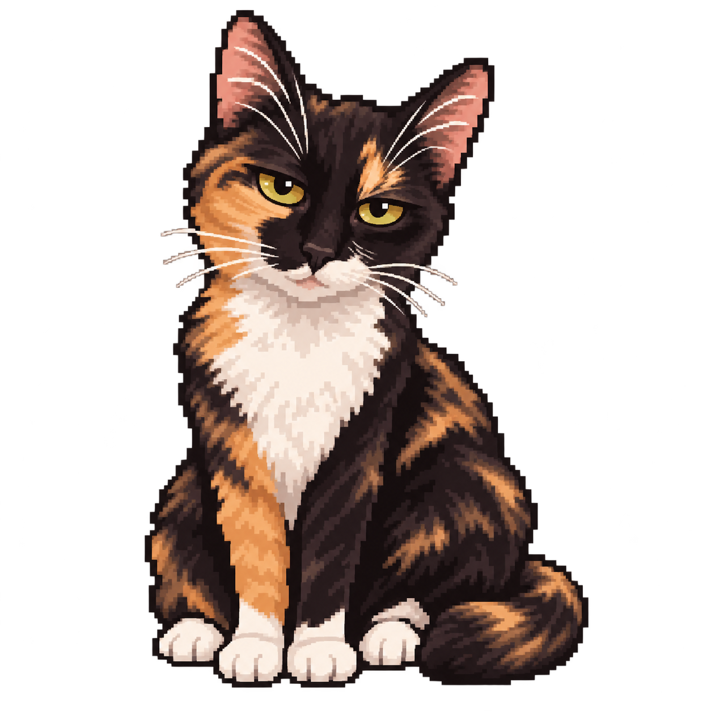
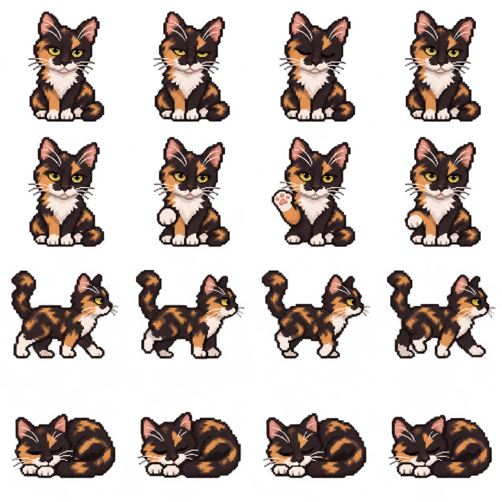

# Evie — EvieScratch mascot assets

Created 21 November 2026 using the built-in image_gen tool, based on the user-supplied photographs of Emily’s female cat. There is one mascot, Evie. Preserve her identity across all future expressions, poses, and animation.

## Owner animation delivery specification

For the next animation handoff, export **512 × 512 pixels per frame**, **24 frames per second**, **transparent RGBA background**, as **animated WebP**. Supply a separate **512 × 512 transparent PNG still** for each animation for reduced motion, loading and hidden-document fallback. These are source delivery sizes, not the on-screen display dimensions; the app currently displays Evie at roughly 57–120 CSS pixels wide and will generate smaller optimized derivatives. New files are not integrated until supplied and reviewed.

Keep the entire cat within x=32–480 and y=32–480. Use a shared centerline at x=256 and floor at y=480; the same pose must keep the same scale and position between frames. Do not crop individual frames to different bounds. Leave headroom for ears/paws, preserve Evie's asymmetric calico markings and never mirror her. No text, background, baked lighting effects or audio.

Requested clips (separate files):

| Filename | Duration / frame count at 24 fps | Playback intent |
| --- | --- | --- |
| `evie-sleep.webp` | 6 seconds / 144 frames | Seamless loop with a barely visible breath; browsing companion |
| `evie-blink.webp` | 0.25 seconds / 6 frames | One blink, eyes open at beginning/end; app schedules it once every random 6–14 seconds |
| `evie-intro.webp` | 1.5 seconds / 36 frames | Play once: scratch the Journal, settle/tuck in; no text or skip graphic |

Include matching `evie-sleep.png`, `evie-awake.png`, and `evie-intro.png` static stills. If WebP export is unavailable, send a ZIP of numbered transparent PNG frames (`0001.png`, etc.) in separate folders with the same dimensions/frame counts; the application build can derive delivery formats. Keep high-quality source files; final download size is an optimization step after visual review.

## Delivered animation masters (21 November 2026)

Created using pixel-art masters derived from Evie's photographic calico identity and the 16-pose atlas:

| File | Actual size | Duration / Frames | Use |
| --- | --- | --- | --- |
| `evie-intro.webp` | 512 × 512 RGBA | 3.5 seconds / 84 frames at 24 fps | Mascot intro: Evie looks down at the journal, scratches it, and files it into the notes shelf |
| `evie-intro.png` | 512 × 512 RGBA | Static still | Fallback still / reduced motion |
| `evie-sleep.webp` | 512 × 512 RGBA | 5.0 seconds / 120 frames at 24 fps | Sleeping companion: deep breathing loop, ear twitch, and playful tail flicks |
| `evie-sleep.png` | 512 × 512 RGBA | Static still | Fallback still / reduced motion |
| `evie-yawn.webp` | 512 × 512 RGBA | 3.0 seconds / 72 frames at 24 fps | 3-second yawning animation with tongue, canines and shudder |
| `evie-yawn.png` | 512 × 512 RGBA | Static still | Fallback still / reduced motion |

## Delivered files

| File | Actual size | Use |
| --- | --- | --- |
| `evie-mascot.png` | 1254 × 1254 RGBA; approximately 875 KiB | Main seated pixel-art mascot; transparent background |
| `evie-spritesheet.png` | 1254 × 1254 RGBA; approximately 1.45 MiB | 16 static pose frames in four rows and four columns; transparent background |
| `evie-spritesheet.json` | JSON atlas manifest | Exact source rectangles, frame names, uniform virtual canvas size, suggested sequences |
| `GENERATION-PROMPTS.MD` | Markdown | Full final prompts, reference roles, generation method, requested versus actual dimensions |

T01 production derivative: [`../../public/images/evie.webp`](../../public/images/evie.webp), cropped to the transparent artwork bounds and resized to 216×220 (10,842 bytes), without mirroring or changing markings. The notes-list footer displays it at 86×88 on larger screens and 66×68 on phones. The original masters remain unchanged.

## Frame order

Read left to right, then top to bottom. All cells show Evie; these are not different cats.

| Row | Frame 1 | Frame 2 | Frame 3 | Frame 4 |
| --- | --- | --- | --- | --- |
| 1 — Idle/blink | Open eyes | Half blink | Closed eyes | Open eyes / ear variation |
| 2 — Paw wave | Rest | Lift | Raised paw / pink pads | Lower |
| 3 — Walk right | Contact | Down | Passing | Up |
| 4 — Sleep | Rest | Inhale variation | Exhale variation | Ear variation |

The local prototype now assembles a short intro, a subtle sleeping breath and a single randomized blink from these frames. Frame names describe intended use; further registration/edge cleanup can follow physical-device review. Never make an endless walking loop part of the writing surface.

## Current runtime derivatives

Existing atlas cells were extracted on a uniform 314×314 transparent canvas, without mirroring or modifying the master sheet. Idle open/half/closed frames form a 648×216 WebP strip; sleep-rest is cropped to its sleeping body; wave-rest/lift/lower provide the intro poses. A code-native Journal supplies the scratching/tucking prop.

| Runtime asset in `public/images/` | Bytes | Loading/use |
| --- | ---: | --- |
| `evie-awake-strip.webp` | 45,870 | Open note; one 240 ms blink every random 6–14 seconds |
| `evie-sleeping.webp` | 14,610 | Home/browsing; 0.6% breath over 6.8 seconds |
| `evie-intro-rest.webp` | 19,104 | Intro, 240×240 |
| `evie-intro-lift.webp` | 19,012 | Intro, 240×240 |
| `evie-intro-scratch.webp` | 18,960 | Intro, 240×240 |

The intro poses plus sleeping image total 71,686 bytes; the awake strip loads when a note opens. All new derivatives together are 117,556 bytes, above the original total mascot target of 100 KB. Intro is 1.5 seconds on accent green with a final fade, no text/buttons. Hidden documents pause mascot movement; reduced motion disables it. Desktop-browser mobile review confirmed sleeping/awake presentation; physical phones remain untested.

## Identity guide

- Mostly black/dark-chocolate face, with a dark central forehead/nose bridge and dark nose.
- Broad ginger patch on her anatomical right cheek, viewer-left in the front view.
- Smaller upright ginger blaze above her anatomical left eye, viewer-right in the front view.
- Golden yellow-green eyes, pink inner ears, white chin/lower muzzle and large white chest bib.
- Ginger right foreleg, darker left foreleg, white mittens/socks, mottled black-and-ginger body and tail.
- Keep the same Evie. No selectable coats, different cats, accessories, or collectible pets are part of this delivery.
- **Do not flip the image horizontally** to produce a new direction: that would reverse her real markings.

Primary generation references were the clear calico front-face, relaxed body, lying-body, and side-profile photos. The sleeping image with a predominantly black-and-white appearance was not used to redefine her coat. Photos were read from the supplied screenshot paths; the originals were not changed or moved.

## Integration

The generated dimensions differ from the prompt’s requested dimensions. Both images were inspected as **1254 × 1254 RGBA**, with alpha values ranging from 0 to 255. Every sheet cell contains a visible character, with the opaque character body inside its cell. The files are copied unchanged from the generated outputs.

Because 1254 is not divisible by four, use the JSON source rectangles. Column and row boundaries are **0, 313, 627, 940, 1254**. Individual cells are 313 or 314 pixels wide/high; use a common **314 × 314 virtual frame** and draw each source rectangle at its natural size at the origin. Do not stretch individual cells to match each other. This avoids fractional CSS sprite offsets and unintended per-frame scale changes.

Use a canvas/atlas renderer or extract frames during a later asset-preparation step. Apply nearest-neighbor scaling (`imageSmoothingEnabled = false`, or CSS `image-rendering: pixelated` when appropriate), preserve alpha, and compare visibility on both light and dark surfaces. Artwork has partially transparent edge pixels; it is generated pixel-style art, not a certified native-resolution hand-pixelled game atlas. Some pose registration and edge cleanup may be appropriate before polished looping animation.

The JSON includes suggested timings only. Tune them after viewing actual playback. Honor reduced motion, pause off-screen/background animation, and keep the editor responsive. Save/sync success must still be communicated with accessible text; Evie is decorative company, not the sole status indicator.

## Performance note

These are master artwork assets, not the final tiny runtime payload. The approximately 100 KB mascot budget in the product brief remains a future optimization target and is not met by these full-resolution PNG masters. Before production, prepare appropriately sized derivatives with nearest-neighbor scaling, lossless transparency, and verified visual quality; load only the needed asset. Do not force this full sheet into the initial editor bundle.

## Generation provenance

Built-in image_gen mode was used; no external API key or fallback CLI. Full prompts are preserved in `GENERATION-PROMPTS.MD`. No paid stock illustration or Cat on Chair artwork was copied. The references establish Evie’s appearance; the mascot art is newly generated for EvieScratch.
